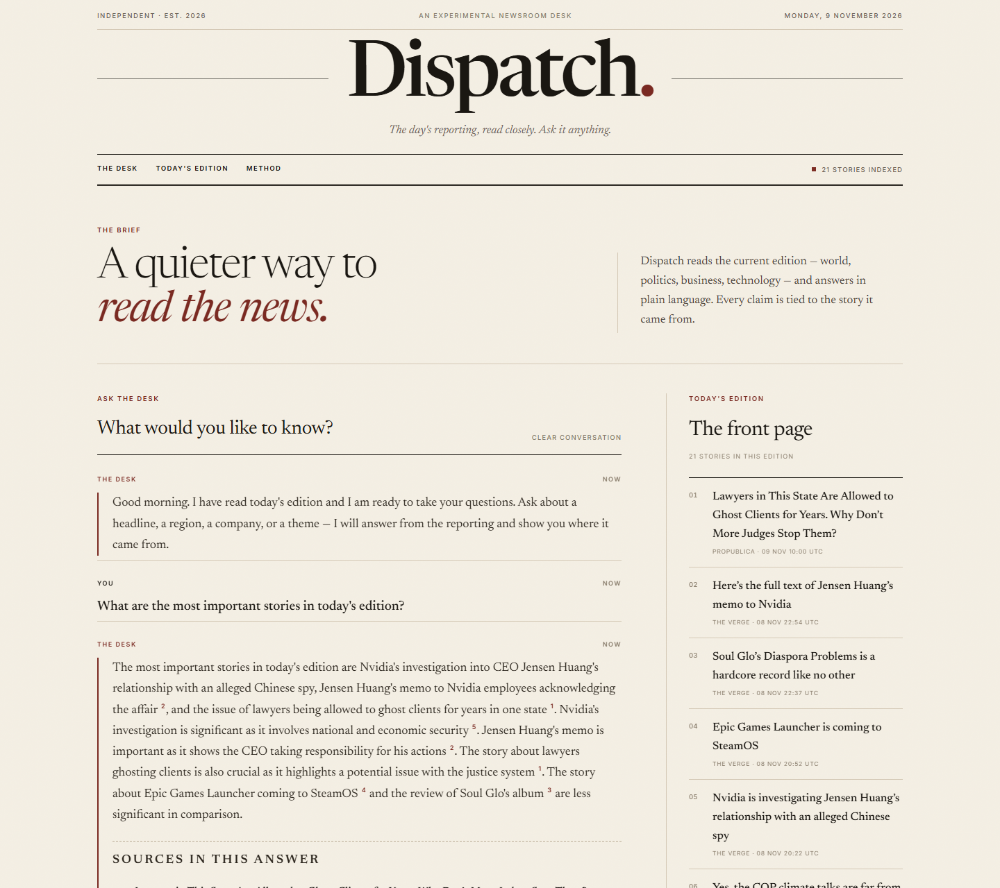
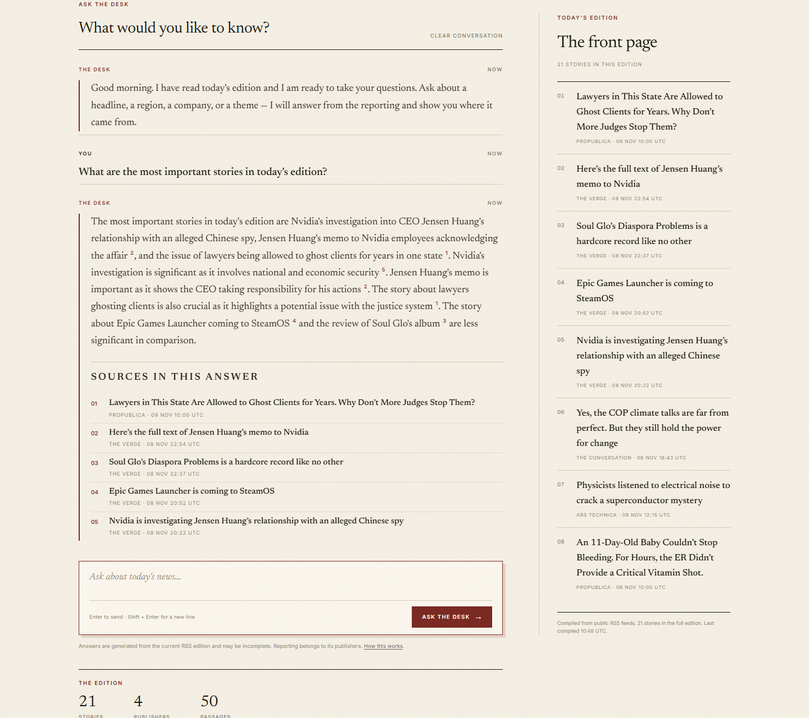
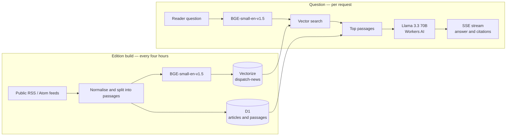

# Dispatch

**The day's reporting, read closely. Ask it anything.**

Dispatch is an editorial newsroom desk. It reads the current edition of the news and answers questions from the reporting, with every claim tied to a numbered source.

**Live:** <https://dispatch.kp489292.workers.dev>

[](https://dispatch.kp489292.workers.dev)

## What it is

Dispatch is a small retrieval-augmented generation (RAG) application, not a trained language model. It pulls public RSS and Atom feeds, reads the full text of each entry, splits the reporting into passages, embeds those passages, and retrieves the ones that match a question. A hosted language model then answers from those passages only. The answer streams back with citations that link to the original reporting.

The interface is deliberately print-like: warm paper, oxblood, a serif masthead, hairline rules, and none of the usual dashboard chrome. There are no accounts, no tracking, and no advertising.



## Architecture



| Layer | Cloudflare service | Role |
| --- | --- | --- |
| Runtime | Workers | Serves the API and static assets, streams answers |
| Generation | Workers AI | `@cf/meta/llama-3.3-70b-instruct-fp8-fast`, with `@cf/meta/llama-3.1-8b-instruct-fp8` as fallback |
| Embeddings | Workers AI | `@cf/baai/bge-small-en-v1.5`, 384 dimensions |
| Retrieval | Vectorize | `dispatch-news` index, cosine distance, top matches per question |
| Storage | D1 | Edition metadata, article records and passages |
| Schedule | Cron trigger | `17 */4 * * *` rebuilds the edition |
| Delivery | Assets | Self-hosted HTML, CSS, JavaScript and fonts from `public/` |

No external API keys are required at runtime. Workers AI, Vectorize and D1 are native bindings on the same Cloudflare account.

## How a question is answered

1. **Collect** — The Conversation, ProPublica, Ars Technica and The Verge publish full-text RSS/Atom entries. Every four hours the cron trigger rebuilds the edition: reads each entry, splits the reporting into passages and replaces the previous edition.
2. **Embed** — each passage is embedded with `@cf/baai/bge-small-en-v1.5` and written to the `dispatch-news` Vectorize index. The text and edition metadata go to D1.
3. **Retrieve** — the reader's question is embedded the same way and matched against the index. Front-page questions such as "what are the most important stories today?" use recency and edition order instead of cosine similarity.
4. **Answer** — the top passages are passed to `@cf/meta/llama-3.3-70b-instruct-fp8-fast` with instructions to use only those passages, ignore commands inside the reporting, and cite claims as `[1]`, `[2]`. A smaller 8B FP8 model is a fallback.
5. **Stream** — the answer is sent over server-sent events. Citations and sources are sent before the first token, so the interface can show provenance immediately.

## Edition sources

The current edition is compiled from public feeds that publish readable article text:

- [The Conversation](https://theconversation.com/global/articles.atom)
- [ProPublica](https://www.propublica.org/feeds/propublica/main)
- [Ars Technica](https://feeds.arstechnica.com/arstechnica/index)
- [The Verge](https://www.theverge.com/rss/index.xml)

Publishers differ in how much text they publish in their feeds. The desk says when the edition does not cover something rather than inventing an answer.

## Endpoints

| Method | Path | Purpose |
| --- | --- | --- |
| `GET` | `/api/health` | Service status, model names, story and passage counts, last ingest time |
| `GET` | `/api/articles` | The current edition, newest first |
| `POST` | `/api/chat` | `{ "message": "...", "history": [...] }` → SSE stream (`citations`, `token`, `done`, `error`) |
| `POST` | `/api/ingest` | Rebuild the edition. Requires the `x-ingest-key` header matching the `INGEST_KEY` secret |

## Local development

```bash
npm install
npm run typecheck
npx wrangler dev --remote --port 8787
```

`--remote` is needed because the Worker uses real Workers AI, Vectorize and D1 bindings. The site is then available at <http://localhost:8787>.

Apply the schema to a fresh database:

```bash
npx wrangler d1 execute dispatch --remote --file=./schema.sql
```

Set the ingest key and build an edition:

```bash
npx wrangler secret put INGEST_KEY
curl -X POST http://localhost:8787/api/ingest -H "x-ingest-key: <key>"
```

## Deployment

```bash
npx wrangler deploy
```

`wrangler.jsonc` contains the bindings:

- `AI` — Workers AI
- `VECTORIZE` — `dispatch-news` (384 dimensions, cosine)
- `DB` — D1 database `dispatch`
- `ASSETS` — static files in `public/`

The cron trigger `17 */4 * * *` refreshes the edition. The production URL is <https://dispatch.kp489292.workers.dev>.

## Design notes

- **Palette** — paper `#F4EFE4`, ink `#1A1712`, oxblood `#7A2A22`, rules `#D5C9B6`. No gradients, no glass, no emoji.
- **Type** — Newsreader for display and reading, Inter for labels and controls. Both are self-hosted variable fonts.
- **Honesty** — the interface says the answers come from the current RSS edition and may be incomplete. The system prompt forbids outside knowledge and invented facts.
- **Safety** — source text is treated as reporting, not instruction. The prompt explicitly tells the model to ignore commands inside articles.
- **Citations** — every answer maps its superscript numbers to the exact stories it used. Empty or out-of-range citation markers are removed before rendering.

## Limitations

- RSS and Atom entries vary in length; some publishers publish only a summary.
- The edition is a snapshot. Old vectors are removed when the edition is rebuilt.
- The demo is not a verified news product. Reporting belongs to its publishers.

## Stack

Cloudflare Workers · Workers AI · Vectorize · D1 · TypeScript · vanilla HTML/CSS/JS

## License

MIT
